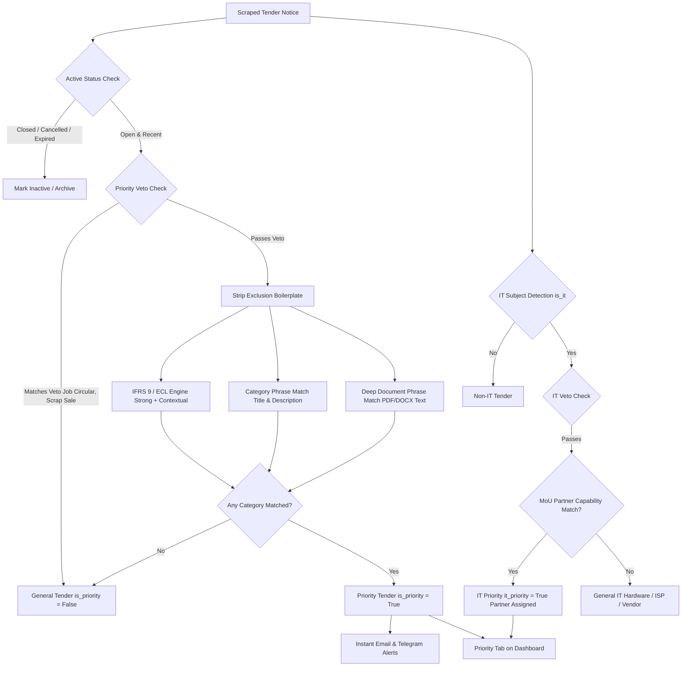

# Tender Priority Selection Logic & Architecture

This document explains how the ACNABIN Tender Agent selects the **Priority** of tenders, detailing the underlying business rules, algorithmic flow, and configuration architecture.

---

## 1. Executive Summary & Design Philosophy

The ACNABIN Tender Agent monitors dozens of procurement sources across Bangladesh—including Commercial Banks, Non-Bank Financial Institutions (NBFIs), Development Partners, NGOs, and Government e-Procurement portals.

Every tender found on a monitored source is collected, but the system bifurcates opportunities into two operational tiers:

* **General**: Every active tender notice scraped from any monitored source (e.g., procurement of office stationery, construction, air conditioning, vehicles, security guards).
* **Priority**: Active notices that directly match the **professional service capabilities** of **ACNABIN Chartered Accountants** or its designated **MoU technology partners**.

### Guiding Principles

1. **Deterministic Rule Engine (Zero AI Hallucination in Pipeline)**:
   Priority classification is strictly deterministic, powered by compiled regular expressions with word boundary enforcement (`\b` or negative lookarounds) defined in [`config/relevance.json`](file:///f:/Tender%20Agent/config/relevance.json) and executed in [`app/classification/relevance.py`](file:///f:/Tender%20Agent/app/classification/relevance.py).
2. **Conservative Matching (High Precision over Raw Recall)**:
   False positives erode partner trust. The system incorporates aggressive exclusion filters and title vetoes to eliminate job vacancies, scrap auctions, and bidder eligibility boilerplate.
3. **Multi-Tiered Text Inspection**:
   Listing titles, notice descriptions, and full tender document texts (PDF/DOCX) are evaluated with different confidence constraints.
4. **Two Distinct Priority Dimensions**:
   * **General / Core Services Priority (`is_priority`)**: Audit, Tax, VAT, Accounting, Advisory, and IFRS 9 / ECL.
   * **IT Services Priority (`it_priority`)**: Specialized IT services deliverable by ACNABIN or MoU partners ([CipherShield](file:///f:/Tender%20Agent/config/relevance.json) and [Brain Station 23](file:///f:/Tender%20Agent/config/relevance.json)).

---

## 2. High-Level Data Flow



---

## 3. Core Professional Services Priority (`is_priority`)

The class [`RelevanceClassifier`](file:///f:/Tender%20Agent/app/classification/relevance.py#L39-L129) evaluates whether a notice qualifies for ACNABIN's core professional practice.

### Step 1: Active Status Evaluation
Before priority is assigned, the tender must be active:
* **Status**: Must be `OPEN` (not `CLOSED`, `CANCELLED`, `AWARDED`, `WITHDRAWN`, or Bengali `বাতিল`).
* **Deadline / Recency**:
  * If a deadline exists: `deadline >= current_time`.
  * If no deadline is stated: `published_date >= today - 7 days`.
  * If neither is known: `first_seen >= current_time - 7 days` (on an active source).

### Step 2: Priority Veto (Hard Disqualification)
If the **title** matches any pattern in `priority_veto`, the opportunity is immediately disqualified:
* **Job & Recruitment Notices**: `recruitment`, `vacancy`, `vacancies`, `job circular`, `job opening`, `career`, `internship`.
* **Disposals**: `sale of old`, `sale of used`, `sale of scrap`, `selling of`, `auction`.

*Why*: Organizations frequently post employment circulars (e.g., *"Recruitment of Internal Auditor (Officer)"*) or auction off assets on tender boards. These are internal HR or disposal matters, not procurement of external audit or advisory firms.

### Step 3: Noise & Boilerplate Exclusion Stripping
Tender notices and documents are filled with bidder compliance instructions (e.g., *"Bidders must submit last 3 years audited financial statements, TIN, and VAT registration certificate"*). Without filtering, almost every tender would trigger an "Audit" or "Tax" keyword match.

Before running category checks, the engine strips these phrases from the working text:
* **Engineering / Safety Audits**: `energy audit`, `fire safety audit`, `electrical audit`, `structural audit`, `safety audit`, `environmental audit`.
* **Bidder Submission Requirements**: `audited financial statements`, `audited reports of the bidder/firm`, `TIN/BIN registration`, `VAT clearance certificate`, `tax return certificate`, `inclusive of VAT and AIT`.
* **IT / Facility Artifacts**: `audit vault`, `audit trail`, `audit log`, `internal control & compliance division` (when referring to an office room or division branch).
* **Physical Asset Valuations**: `land valuation`, `property valuation`, `surveyor and valuer`.

### Step 4: IFRS 9 / Expected Credit Loss (ECL) Detection
IFRS 9 and ECL model validation represent high-value consulting engagements for banks and NBFIs. Detection is split into two tiers:

1. **Strong Indicators (Immediate Priority Hit)**:
   * Patterns: `IFRS 9`, `আইএফআরএস ৯`, `expected credit loss`, `ECL model/framework/validation/review`, `impairment of financial instruments`.
   * Found in title, description, or tender document text.
2. **Contextual Indicators (Sliding Window Matching)**:
   * Ambiguous terms like `ECL`, `PD`, `LGD`, `SICR`, or `impairment model` do not trigger on their own (preventing false alarms like "ECL office rent" or "PD vehicle supply").
   * They must occur within a **200-character window** alongside contextual keywords such as `model`, `methodology`, `IFRS`, `staging`, `probability of default`, `loss given default`, or `provision`.

### Step 5: Service Category Matching
Matches the cleaned text against 7 core practice categories:

| Category Code | Category Label | Sample Qualifying Title / Description Phrases | Deep Document Phrases (PDF/DOCX) |
| :--- | :--- | :--- | :--- |
| **`AUDIT`** | Audit & Assurance | `audit`, `statutory audit`, `internal audit`, `assurance engagement`, `agreed-upon procedures`, `নিরীক্ষা`, `অডিট ফার্ম` | `appointment of external audit firm`, `audit of financial statements`, `terms of reference for external audit` |
| **`IT_AUDIT`** | IT / IS Audit | `IT audit`, `IS audit`, `information systems audit`, `SWIFT CSP assessment`, `ISO 27001 audit/certification` | `information systems audit`, `SWIFT CSP independent assessment` |
| **`RISK_CONTROL`** | Risk & Internal Control | `internal controls`, `control framework`, `risk advisory`, `enterprise risk management (ERM)`, `AML/CFT review`, `asset quality review (AQR)` | `internal control assessment/review`, `enterprise risk management framework` |
| **`ACCOUNTING`** | Accounting & Financial Reporting | `IFRS` (non-9), `IAS`, `financial reporting`, `preparation of financial statements`, `chart of accounts`, `bookkeeping` | `preparation of financial statements`, `IFRS conversion/adoption` |
| **`TAX_VAT`** | Tax & VAT | `tax consultancy`, `VAT consultant`, `income tax advisor`, `transfer pricing`, `tax return filing`, `কর পরামর্শক`, `ভ্যাট উপদেষ্টা` | `tax/VAT advisory services` |
| **`ADVISORY`** | Financial & Management Advisory | `due diligence`, `business valuation`, `fixed asset verification/tagging`, `business process re-engineering (BPR)`, `financial feasibility`, `debt restructuring` | `financial due diligence`, `business process re-engineering` |
| **`TRAINING`** | Professional Training | `IFRS training`, `audit training`, `tax and VAT training`, `internal control capacity building` | *(Title/Description only)* |

#### Important Rules for Category Phrase Matching:
* **Listing Text vs. Document Text**:
  * Generic phrases (e.g., `audit`, `accounting services`, `tax consultant`) are matched **only** against the listing title and summary description.
  * Only strict, unambiguous procurement formulations in `document_phrases` (such as *"appointment of external audit firm"*) are permitted to match inside downloaded tender documents.
* **Bangla Support**:
  * English words use boundary checks (`\b` or negative lookarounds); Bengali phrases (e.g., `নিরীক্ষা`, `আয়কর উপদেষ্টা`) use non-boundary matching because Bengali prefixes and case suffixes attach directly to root words.

### Final Core Priority Evaluation
$$\text{is\_priority} = (\text{len}(\text{categories}) > 0) \land \neg(\text{vetoed})$$

---

## 4. IT Services Priority (`it_priority`)

The [`ItClassifier`](file:///f:/Tender%20Agent/app/classification/relevance.py#L140-L181) handles technology and cyber tenders, catering to both ACNABIN and its strategic MoU delivery partners.

### Step 1: IT Subject Detection (`is_it`)
A tender is marked as an IT tender (`is_it = True`) if:
1. It originates from an IT-specific procurement source (e.g., Bangladesh Computer Council, ICT Division, Alltender ICT category); **OR**
2. It matches IT keywords in the title or summary: `software`, `cyber security`, `ERP`, `data center`, `cloud`, `VAPT`, `API`, `core banking`, `network infrastructure`, `CCTV`, etc.
3. *Exclusion check*: Excludes civil infrastructure terms like `water distribution network`, `road network`, or standard portal disclaimers like `available on our website`.

### Step 2: IT Priority Veto
Excludes vendor pre-qualification or disposal: `enlistment`, `pre-qualification of vendors`, `auction`, `scrap`, `recruitment`.

### Step 3: Capability & MoU Partner Mapping
Not every IT tender is an IT Priority. Standard equipment supply (e.g., *Supply of 50 desktop computers*, *Internet bandwidth supply*) remains **General IT**.

An opportunity becomes **IT Priority** (`it_priority = True`) only when it aligns with capabilities deliverable by ACNABIN or its MoU partners:

```
+--------------------------------------------------------------------------------------------------+
|                                    IT PRIORITY CAPABILITIES                                     |
+------------------------------------+-----------------------------+-------------------------------+
| Capability Area                    | Assigned Partner(s)         | Key Qualifying Phrases        |
+------------------------------------+-----------------------------+-------------------------------+
| IT / IS Audit & Assurance          | ACNABIN                     | IT/IS Audit, ITGC, Core       |
|                                    |                             | Banking Audit, IT Compliance  |
+------------------------------------+-----------------------------+-------------------------------+
| IT Advisory & Digital              | ACNABIN                     | IT Strategy, Enterprise       |
| Transformation                     |                             | Architecture, PMO, SRS        |
+------------------------------------+-----------------------------+-------------------------------+
| Security Compliance                | ACNABIN + CipherShield      | SWIFT CSP, PCI DSS, ISO 27001,|
|                                    |                             | CSCF, Bangladesh Bank ICT     |
+------------------------------------+-----------------------------+-------------------------------+
| Cyber Security Services            | CipherShield                | VAPT, Penetration Testing,    |
|                                    | (PCI QSA, CREST-listed)     | SOC as a Service, SIEM, vCISO |
+------------------------------------+-----------------------------+-------------------------------+
| Software Development &             | Brain Station 23            | Custom Software Dev, Mobile   |
| Implementation                     | (Software Partner)          | Apps, Digital Lending, AI/ML  |
+------------------------------------+-----------------------------+-------------------------------+
```

---

## 5. Downstream Consumption & Alerting

Once classified, the Priority flags govern how data is routed and presented:

### 1. Database View (`v_active_tenders`)
Implemented in [`supabase/migrations/20261007000008_it_relevance.sql`](file:///f:/Tender%20Agent/supabase/migrations/20261007000008_it_relevance.sql):
* Dynamically filters tenders where `status = 'OPEN'` and deadline/publication date meets recency rules.
* Directly exposes `is_priority`, `is_ifrs9`, `categories`, `matched_keywords`, `is_it`, `it_priority`, `it_categories`, and `it_partners`.

### 2. Real-Time Alert Engine ([`app/alerts/`](file:///f:/Tender%20Agent/app/alerts/))
* **Email Alerts** ([`email.py`](file:///f:/Tender%20Agent/app/alerts/email.py)):
  * Aggregates newly discovered Priority tenders (`id in new_ids and not is_baseline`).
  * Highlight format: `"[N] new ACNABIN priority tenders ([M] IFRS 9 / ECL)"`.
  * Non-priority general tenders are **never emailed**.
* **Telegram Alerts** ([`telegram.py`](file:///f:/Tender%20Agent/app/alerts/telegram.py)):
  * Sends instant notifications with direct tender links and category tags when a Priority tender is detected.

### 3. Dashboard Experience ([`dashboard/`](file:///f:/Tender%20Agent/dashboard/))
* **Tab Filtering**: Users toggle between **All Notices** (General) and **Priority Notices**.
* **Badge Identification**:
  * `Priority` badge (Golden/Teal badge for core professional services).
  * `IFRS 9 / ECL` badge (Highlighted badge for ECL/IFRS 9 opportunities).
  * Partner pills on IT page: `[ACNABIN]`, `[CipherShield]`, `[Brain Station 23]`.
  * Category pills displaying exact matched competencies.

---

## 6. How to Update or Tune Priority Rules

All classification logic is driven by configuration without requiring code changes to the pipeline engine:

1. **To add a new service keyword**:
   Edit [`config/relevance.json`](file:///f:/Tender%20Agent/config/relevance.json) under `categories -> [category_code] -> phrases`.
2. **To suppress a new false positive boilerplate phrase**:
   Add the phrase to `exclusions` in [`config/relevance.json`](file:///f:/Tender%20Agent/config/relevance.json).
3. **To onboard a new IT MoU partner**:
   Add the capability entry under `it -> capabilities` in [`config/relevance.json`](file:///f:/Tender%20Agent/config/relevance.json) and set the `"partner"` field to the new partner's name.
4. **Validation**:
   Always run test suite after updating rules:
   ```bash
   pytest tests/test_relevance.py tests/test_it_sources.py
   ```
